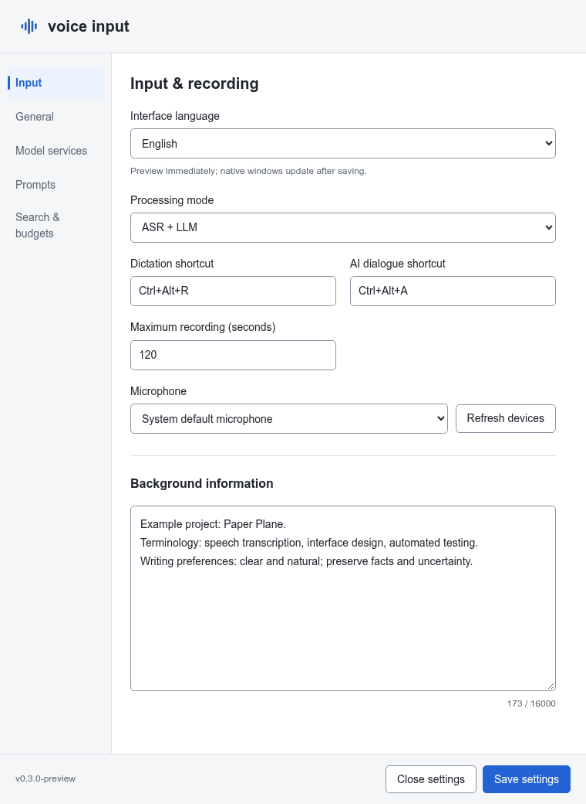
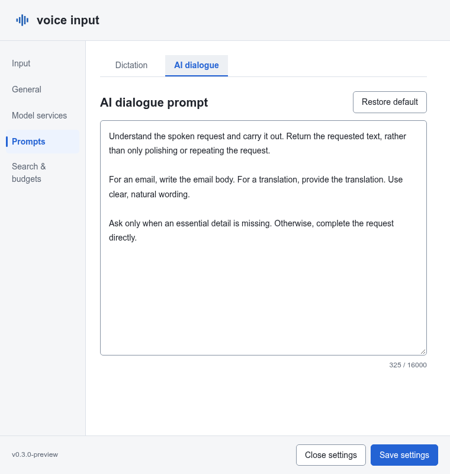
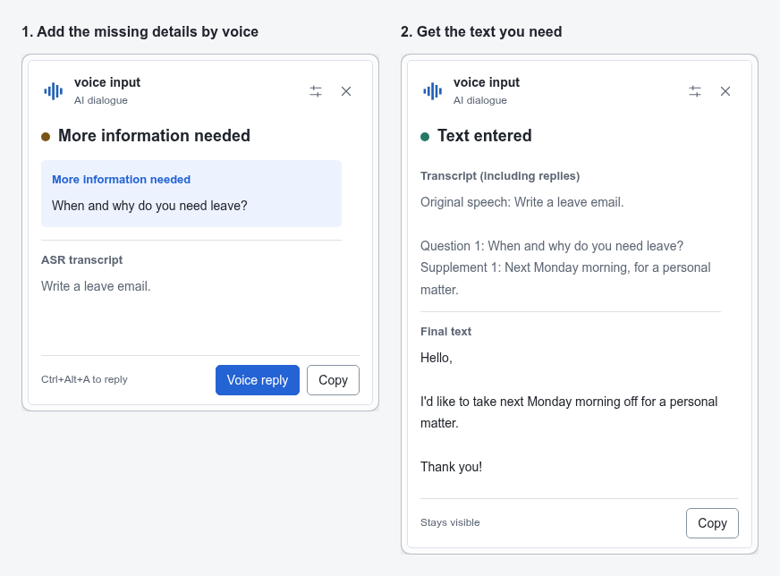

# voice input

**English** | [中文](README.zh-CN.md)

A Windows voice-input utility with two separate shortcuts: **polish what you say** or **ask AI to produce the text you need**. Results are inserted at the currently active input location. The application does not press Enter or send messages automatically.

The interface supports English and Simplified Chinese. Choose a language in Input settings, or follow the system language; save to apply it to the desktop popup and tray.

## Two modes

| Mode | Default shortcut | Saying “write a leave-request email” |
|---|---|---|
| Voice polishing | `Ctrl+Alt+R` | Polishes the request itself |
| AI dialogue | `Ctrl+Alt+A` | Produces the email text; asks for clarification when needed |

- **Voice polishing:** correct grammar, contextually clear idiom misuse and awkward wording; remove filler and redundancy while preserving facts, intent and uncertainty. It does not execute spoken requests.
- **AI dialogue:** write, translate, answer questions or generate code. Answer clarification questions with additional voice turns within the same task.
- **Editable prompts:** separate business instructions for each mode, with independent reset-to-default controls and optional background context.
- **Optional Exa search:** AI dialogue only. Configure search attempts and tool rounds independently; zero tool rounds disables tools.
- **Single- and multi-line input:** Unicode input for a single line; clipboard paste for paragraphs and code, without simulated Enter/Shift+Enter.
- **Desktop controls:** tray access, editable global shortcuts, microphone selection, real input-level feedback, single-instance protection and a topmost popup that does not take focus.
- **General settings:** optional Windows login startup (including administrator startup with UAC authorization), automatic result copying, playback muting while recording with state restoration, and a 1–3600-second result display duration (default 30 seconds). New switches are off by default.

## Download and run

Download `voice_input-<version>-windows-amd64.zip` from this repository's **[Releases](https://github.com/rainluoyu/Voice-Input/releases)** page, extract it into a user-writable folder and run without administrator privileges.

You need **Windows 10/11 x64**, Microsoft Edge WebView2 Evergreen Runtime, a microphone and configured ASR/LLM services. ASR supports OpenAI-compatible and MiMo protocols; Exa is optional. Builds are unsigned: verify the source and SHA-256, and do not disable security protections or elevate privileges to bypass warnings.

## Get started

1. Start `voice_input.exe`. Use the tray icon to open settings; incomplete configuration opens settings automatically.
2. Save service addresses, models and ASR protocol, then save the corresponding API keys separately. Connection tests use saved settings and may incur charges.
3. Place the cursor in a disposable text editor. Use the same shortcut once to start recording and again to stop.
4. If AI asks a clarification question, use the AI dialogue shortcut or the popup's reply button to record your answer.

An unfinished task cannot be replaced or stopped by the other mode's shortcut. Closing the popup cancels the task; closing settings does not quit the application. Use the tray menu to exit.

Configuration lives in `config.json` beside the EXE; API keys are stored separately in Windows Credential Manager. Copying configuration does not transfer keys.

## Interface and workflow

These are browser-rendered Web previews with fictional data; the native Windows task popup may look different.

**Input settings: choose shortcuts and a microphone, and supply background context.**

**Separate prompts: adjust voice-polishing style and AI dialogue instructions.**

**Voice clarification: supply missing details, then get the text you need.**

## Before you use it

- **There is no focus, target-window or password-field check.** Output goes to whichever location is active when processing completes. Confirm the destination yourself.
- Multi-line automatic input and manual Copy **replace the clipboard**; the old contents are not restored. A target application may interpret a paste as execution or submission even though this utility does not press Enter.
- Audio goes to your configured ASR. AI processing sends transcription, supplied background and relevant clarification history to your configured LLM; optional search sends queries to Exa. Services may charge fees and have their own retention policies.
- Start with fictional text in a disposable editor, not passwords or messages you intend to send.

## Help and license

[User guide (Chinese)](docs/USER_GUIDE.md) · [Release notes (Chinese)](docs/RELEASE_NOTES.md) · [Development guide (Chinese)](docs/DEVELOPMENT.md)

Licensed under **[GPL-3.0-only](LICENSE)**. Commercial use is allowed; distribution must comply with the license, including corresponding-source obligations. Third-party components retain their own licenses; portable packages collect notices under `licenses/`.
