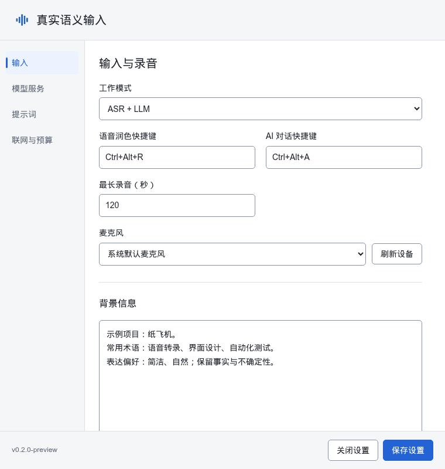
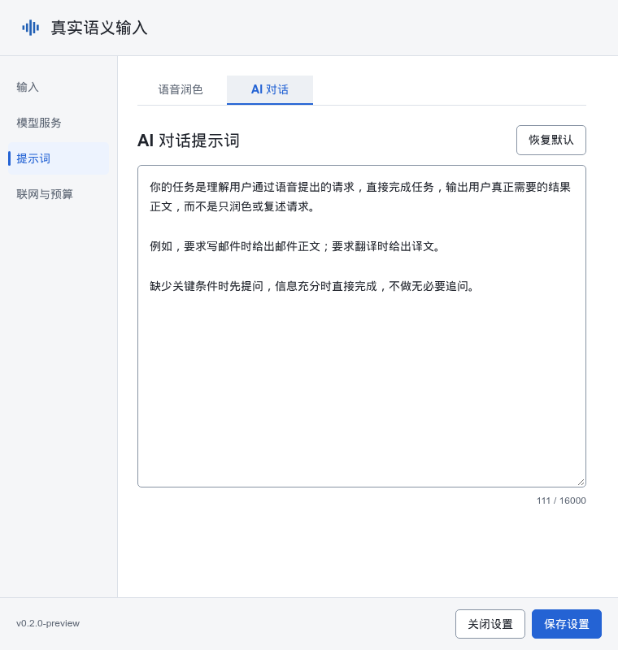
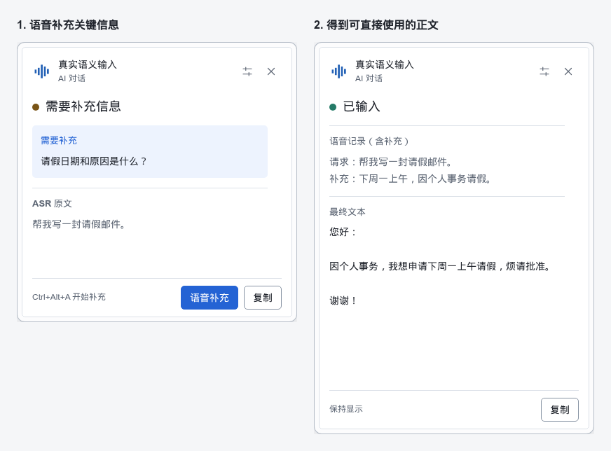

# 真实语义输入 · True Semantic Input

[English](README.md) | **中文**

Windows 语音输入工具：用不同快捷键选择**语音润色**或 **AI 对话**，把口述整理成文本，或直接生成请求所需的正文。结果输入处理完成时的当前活动位置。**不自动按 Enter，不额外发送消息。**

应用界面目前为中文。

## 两种用途

| 用途 | 默认快捷键 | 口述“帮我写一封请假邮件” |
|---|---|---|
| 语音润色 | `Ctrl+Alt+R` | 润色请求本身，不生成邮件 |
| AI 对话 | `Ctrl+Alt+A` | 生成邮件正文；必要时先提问 |

- **语音润色**：修正语病、语境明确的成语误用和不当措辞，精简口水话与冗余，保留事实、意图和不确定性；不执行口述请求。
- **AI 对话**：写作、翻译、回答或生成代码；遇到澄清问题时，可在同一任务中继续语音补充。
- **自定义提示词**：两种用途独立编辑和恢复默认，可填写额外背景信息。
- **可选 Exa 搜索**：仅 AI 对话使用，搜索次数和工具轮数分别设定；工具轮数为 0 时禁用工具。
- **单行与多行输入**：单行直接 Unicode 输入，多行及代码通过剪贴板粘贴，不模拟 Enter/Shift+Enter。
- **桌面交互**：托盘、可编辑全局快捷键、麦克风选择、真实音量反馈、单实例及不抢焦点的置顶浮窗。

## 下载与运行

从本仓库的 **[Releases](https://github.com/rainluoyu/Voice-Input/releases)** 页面下载 `voice_input-<版本>-windows-amd64.zip`，解压到用户可写目录，使用普通权限运行。

需要 **Windows 10/11 x64**、Microsoft Edge WebView2 Evergreen Runtime、麦克风及 ASR/LLM 服务。ASR 支持 OpenAI-compatible 和 MiMo 协议，Exa 可选。构建未签名，请核对来源和 SHA-256；不要关闭安全防护或提权绕过提示。

## 快速开始

1. 启动 `voice_input.exe`，从托盘打开设置；服务配置不完整时会自动打开设置。
2. 保存服务地址、模型和 ASR 协议，再单独保存对应密钥。“测试连接”使用已保存的配置，可能产生服务费用。
3. 在临时文本编辑器定位光标，用同一快捷键按一次开始录音，再按一次停止。
4. AI 提出澄清问题后，使用 AI 对话快捷键或浮窗的补充按钮录制回答。

未完成任务不能被另一用途的快捷键替换或停止。关闭浮窗会取消任务；关闭设置不会退出程序，完全退出请使用托盘菜单。

配置保存在 EXE 同级的 `config.json`，密钥单独保存在 Windows 凭据管理器；复制配置不会携带密钥。

## 界面与功能

以下为使用虚构数据的浏览器 Web 界面预览；Windows 原生任务浮窗的外观可能不同。

**输入设置：选择快捷键、麦克风，补充背景信息。**

**独立提示词：分别调整润色程度和 AI 对话规则。**

**语音澄清：补充关键信息，再得到需要的正文。**

## 使用前请注意

- **不检查焦点、目标窗口或密码框属性。** 结果进入处理完成时的当前活动位置，请自行确认目的地。
- 多行自动输入和手动复制都会**替换剪贴板，不恢复旧内容**。目标应用可能自行提交或执行粘贴内容，即使程序不按 Enter。
- 音频发送到配置的 ASR；AI 处理将转录、所填背景和相关补充历史发送到配置的 LLM；可选搜索发送查询给 Exa。各服务可能计费，并有独立的数据留存政策。
- 先在临时编辑器中使用虚构内容测试，不要使用真实密码或待发送消息。

## 帮助与许可

[使用与排错](docs/USER_GUIDE.md) · [更新说明](docs/RELEASE_NOTES.md) · [开发文档](docs/DEVELOPMENT.md)

本项目采用 **[GPL-3.0-only](LICENSE)**，允许商用，分发时须遵守对应源码等许可义务。第三方组件保留各自许可证；便携包中的 `licenses/` 收录相应声明。
